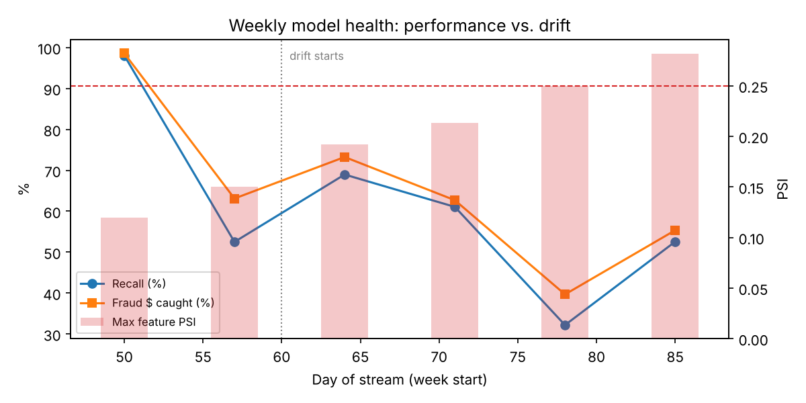

# 🛡️ FraudStream: Real-Time Card Fraud Detection with Drift Monitoring and Grounded Explanations

[](https://github.com/indrareddyds009-source/fraudstream/actions)

An end-to-end fraud system, not just a model: a transaction stream, an **online feature store**
shared by training and serving, a **LightGBM** model with a **cost-optimal decision threshold**, a
**FastAPI scoring service**, **PSI + label-based drift monitoring**, **champion/challenger retraining**,
and **reason codes** turned into analyst notes, optionally by an LLM that is only allowed to restate the
model's own evidence.



## Results (from `python -m fraudstream.pipeline`, synthetic data)

282K transactions from 2,000 cards over 90 days, 0.58% fraud. Full report: [`docs/report.md`](docs/report.md).

| Pre-drift test (days 50-59) | PR-AUC | Recall | Precision | Fraud $ caught | Alerts / 1k | Expected cost* |
|---|---|---|---|---|---|---|
| **LightGBM** | **0.981** | **97.8%** | **70.8%** | **96.5%** | 6.1 | **$1,870** |
| Hand-written rules | 0.032 | 52.5% | 5.7% | 33.7% | 40.7 | $23,790 |

| After drift (days 75-89) | PR-AUC | Recall | Fraud $ caught | Expected cost* |
|---|---|---|---|---|
| Champion v1 (trained days 14-39) | 0.522 | 47.8% | 54.3% | $15,573 |
| **Challenger v2 (retrained days 14-74)** | **0.829** | **92.2%** | **95.8%** | **$3,895** |

*Expected cost = missed fraud dollars + $5 review cost per alert; the threshold is chosen to minimize it.

Serving (single process, `python -m fraudstream.replay`): ~8,700 txn/s, p50 0.07 ms, p99 0.4 ms per
score including feature computation.

**What the drift experiment shows.** From day 60 a new "stealth" pattern appears (victim's own device,
home city, normal hours, gift cards) along with ~15% price inflation. Score PSI stayed low, because
the attack *looks* normal, while recall dropped from 98% to 32-69% per week. The label-based monitor
(recall on delayed chargeback labels) flagged it within a week, and retraining on the newly labeled data
lifted recall on the new pattern from 7.9% to 86.8%. Lesson: unlabeled drift metrics catch covariate
shift; concept drift needs label feedback.

> Synthetic data is cleaner than real card data, so absolute scores are higher than you'd see in
> production. The relative comparisons (model vs. rules, champion vs. challenger) and the engineering are
> the point.

## Architecture

```
 transaction ──▶ FeatureStore.compute()  (velocity, amount z-score, distance & travel speed,
      │            new device / merchant, small-charge bursts, category habits; prior data only)
      │                      │
      │                      ▼
      │              LightGBM score ──▶ approve │ review (≥ cost-optimal τ) │ decline (≥ 0.8)
      │                      │
      │                      ├──▶ reason codes (TreeSHAP contributions) ──▶ analyst note
      │                      │        (template, or LLM with a number-grounding check)
      ▼                      ▼
 FeatureStore.update()   rolling window ──▶ PSI per feature + score  ─┐
                                                                     ├─▶ drift status / retrain trigger
                    delayed labels (chargebacks) ──▶ weekly recall ─┘
```

- **No training/serving skew.** Training builds features by replaying history through the same
  `FeatureStore` the API uses; each feature uses only information from before the transaction.
- **Hard negatives in the data.** Legitimate travel, night owls, new phones, and app-store
  micro-payment bursts mean no single rule separates fraud (which is why the rules baseline fails).
- **Grounded explanations.** `explain.llm_note()` gives the LLM only the score and the top
  contributions, then rejects any note containing a number that is not in those facts.

## Run it

```bash
pip install -r requirements-dev.txt
pytest -q                                    # unit, model, monitoring and API tests
python -m fraudstream.pipeline               # train + monitor + retrain → artifacts/, docs/report.md
python -m fraudstream.replay                 # stream days 50-59 through the live scorer
uvicorn fraudstream.api:app --port 8000      # POST /score · GET /explain/{id}?llm=true · GET /monitor/drift
docker build -t fraudstream . && docker run -p 8000:8000 fraudstream
```

## Project layout

```
fraudstream/
  simulate.py   synthetic stream: legit behaviour, 4 fraud patterns, drift
  features.py   online feature store (train = serve)
  model.py      LightGBM training, cost-based threshold, metrics, model card
  monitor.py    PSI drift + label-based performance checks
  explain.py    TreeSHAP reason codes, template / grounded-LLM notes
  scorer.py     real-time scorer           api.py     FastAPI service
  pipeline.py   full experiment + report   replay.py  stream replay benchmark
```

## Next steps

- Kafka/Redpanda source and Redis-backed feature store for multi-instance serving
- Shadow-deploy the challenger and promote on a significance test
- Graph features (shared devices / merchants across cards)

## License

MIT. All data is synthetic.
