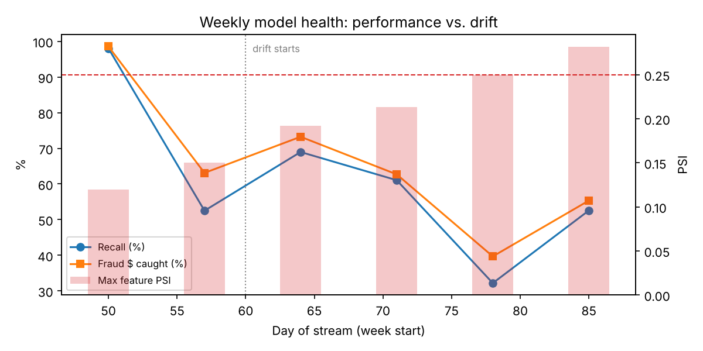

# FraudStream experiment report

282,360 synthetic transactions, fraud rate 0.58%. Days 0-13 warm up card profiles. Train days 14-39, threshold chosen on days 40-49, test days 50-59. Drift begins day 60.

## Test period (pre-drift), threshold 0.030

| Model | PR-AUC | Recall | Precision | Fraud $ caught | Alerts / 1k txns | Expected cost |
|---|---|---|---|---|---|---|
| LightGBM | 0.981 | 97.8% | 70.8% | 96.5% | 6.1 | $1,870 |
| Rules baseline | 0.032 | 52.5% | 5.7% | 33.7% | 40.7 | $23,790 |

## Weekly monitoring

| Week start | Score PSI (unlabeled) | Top drifting features (PSI) | Recall | Precision | Label-based status |
|---|---|---|---|---|---|
| day 50 | 0.034 (ok) | amount_vs_max 0.12, new_merchant 0.11, cat_share 0.03 | 98.1% | 73.2% | ok |
| day 57 | 0.028 (ok) | new_merchant 0.15, amount_vs_max 0.09, amount_z 0.04 | 52.5% | 47.2% | ALERT |
| day 64 | 0.028 (ok) | new_merchant 0.19, amount_vs_max 0.10, amount_z 0.07 | 69.0% | 67.2% | ALERT |
| day 71 | 0.034 (ok) | new_merchant 0.21, amount_vs_max 0.14, amount_z 0.08 | 61.1% | 69.7% | ALERT |
| day 78 | 0.036 (ok) | new_merchant 0.25, amount_vs_max 0.17, amount_z 0.07 | 32.2% | 44.4% | ALERT |
| day 85 | 0.038 (ok) | new_merchant 0.28, amount_vs_max 0.20, cat_share 0.08 | 52.6% | 66.1% | ALERT |

Score and feature PSI stayed below the alert level while recall fell: the new pattern looks like normal traffic, so unlabeled drift metrics alone missed it. Monitoring recall on delayed (chargeback) labels caught it, which is why the service tracks both.

## Retraining after drift (evaluated on days 75-89)

| Model | PR-AUC | Recall | Precision | Fraud $ caught | Alerts / 1k txns | Expected cost |
|---|---|---|---|---|---|---|
| Champion v1 (days 14-39) | 0.522 | 47.8% | 58.7% | 54.3% | 3.5 | $15,573 |
| Challenger v2 (days 14-74) | 0.829 | 92.2% | 37.4% | 95.8% | 10.7 | $3,895 |

Recall on the new 'stealth' pattern: champion 7.9% → challenger 86.8%.

## Top features (gain)

- dist_home_km: 169,784
- txn_1h: 71,313
- cat_share: 65,176
- speed_kmh: 53,604
- amount_z: 31,121
- amount_1h: 27,434
- category: 26,272
- amount: 22,585

_Run time 17.5s. Data is synthetic; see `fraudstream/simulate.py`._
